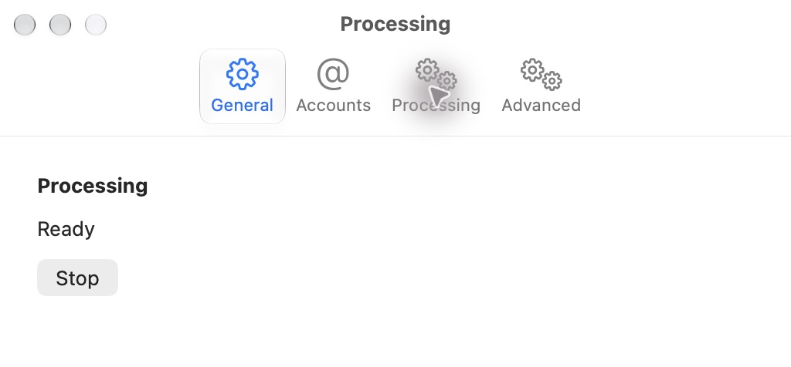
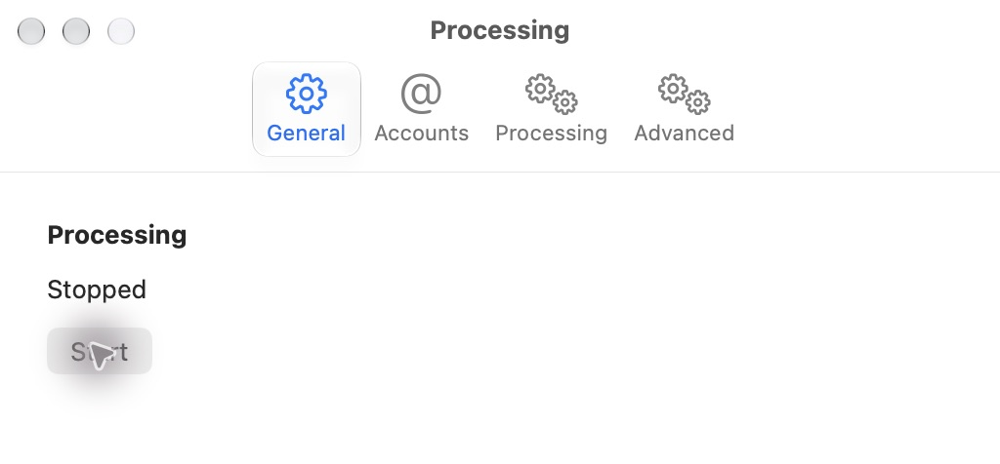
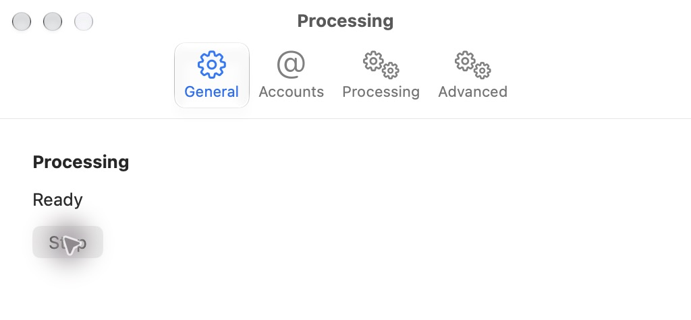

# T02 accepted managed-engine foundation

Accepted source: `920efefd61fb993a850241719a4d99e5691023b6`; implementation evidence: `567cc9ece0bb34e330a650de56e21ef6832fbaae`; original base: `c9ecfa14e884a7ce8895bb13eec3ea8711cbef90`. The evidence commit changes only the ticket record. The coordinator accepted and integrated this developer API and native macOS lifecycle foundation at `e3c6b152214ff4897d5c122c86fed0846c540736`; PR33 is merged and issue4 is closed after [resolution](https://github.com/lostwildland/NoNews/issues/4#issuecomment-6458171742). This is not full Information OS parity, personal cutover or release acceptance.

## Ticket criteria and evidence

| Required behavior | Evidence |
| --- | --- |
| Real reusable IO contracts and portable clean startup | Bundled sanitized service/schema, real database-backed status/settings/jobs; empty roots need no personal IO checkout, FreshRSS or vault. Current signed-bundle harness exercises the installed interpreter and service. Later business handlers remain assigned to their feature tickets. |
| Authenticated private communication and lifecycle/error recovery | Per-launch token, tagged bounded stdio, minimal child environment, bundle-relative discovery, ownership through failed stop, timeout/retry and controlled startup errors. Complete group and connected-interface source reviews plus current public Swift-controller checks. |
| Native launching/Ready/failed/stopped state backed by real storage | The actual settings write/read is rolled back in the real processing database, preserving its prior state. Public failure/rollback tests and native-controller checks pass. CUA directly observed current Ready → Stopped → Ready through the Settings controls. |
| Sanitized public shipping source | Explicit source/root allowlists, byte comparison, no personal writer environment inheritance, configured app-owned roots and recorded provenance. All 70 reviewed ledger paths match the source pin; source and connected-interface reviews clear both axes. |
| Declared dependencies/licenses and actual installed-bundle discovery | Pinned prepared runtime/dependencies and notices; normal isolated app relocated to `/tmp/nonews-t02-r35-installed/NetNewsWire.app`. Identity, deep strict signature and every declared embedded source passed coordinator readback. The normal app lacks the harness-only read exception. |

The source review gate comprises the earlier complete packaging/native/database/jobs inspections and corrections, [R31–R33 correction coverage](t02-cooperative-review-r31-r33.md) and [R34 final connected-interface assessments](t02-connected-review-r34.md). R34 independently verified the exact 70-path union and completed all six requested seams on both axes with zero actionable P1/P2 findings. Reviewers did not claim runtime checks they did not perform.

## Current-source verification

- Owner full Python suite: 63 total, **62 passed and one optional source-comparison skipped**, with ResourceWarning as error. Current public Swift-controller checks pass, including typed capacity refusal and continued service.
- Local isolated `NetNewsWire-CI` plan: **747 passed, zero failed/skipped**. The coordinator independently read `/tmp/nonews-t02-r35-ci.xcresult`. The warning gate passed. This plan deliberately excludes the old name-targeted ScriptingTests until T30's isolated binding is integrated.
- Actual relocated-bundle sandbox harness: **11 passed, EXIT 0**, including schema refusal/preservation, transactions, settings/restart, orphan/aggregate history, frame seek/read cleanup, cooperative broad/deep/scalar progress and controlled capacity refusal. The coordinator read its recorded output. The injected capacity limit is not a native 512 MiB exercise.
- Coordinator readback passed isolated identity, deep strict signature and declared embedded source verification. Native executable SHA-256: `517d66ef664eaad5d540dccc48c7c4a7ca30b2aee62fa1afb60d3cf520792553`. The pre-sign payload manifest describes bytes before Mach-O signing; it is not claimed as a post-signing inventory.

The initial current build failed because generated bytecode entered the prepared manifest. The owner removed only the generated stage bytecode using the assembler's cleanup scope, regenerated the manifest and passed the corrected build. This failed attempt is retained in [implementation evidence](t02-managed-engine.md).

## Observed native controls

The coordinator selected the exact relocated app through CUA, opened Settings and selected Processing. Accessibility text and screenshots showed Ready and Stop. Clicking Stop showed Stopped and Start; clicking Start returned to Ready and Stop. No article, model, integration or processing preference was changed.

The app PID 55010 and then-current child PID 55017 were independently matched to the exact relocated executable and its bundled interpreter before observation. Restart replaces the child; these historical PIDs are not reusable stop targets. This is the current `920efef` artifact, superseding the earlier R11-only visible observation.

## Limits retained after acceptance

The local CI raw log still contains **2,149 disk-I/O diagnostic lines** from the known native fixture-lifetime issue. Those diagnostics are not resolved by the passing count or this acceptance; T30 separately repairs and tests them. Its source `a92a072` has 774 full-plan passes and zero matching diagnostics, but later T30 changes still need verification and review before integration.

Actual GitHub CI, release signing, Intel execution, iOS, CloudKit, old ScriptingTests on this branch, personal migration and external services remain unverified. Full reader/AI/integration/sync journeys belong to the remaining tickets. The complete goal stays active. T03 may now start only from the committed integrated API, with its own native configuration and size/error requirements unchanged.
